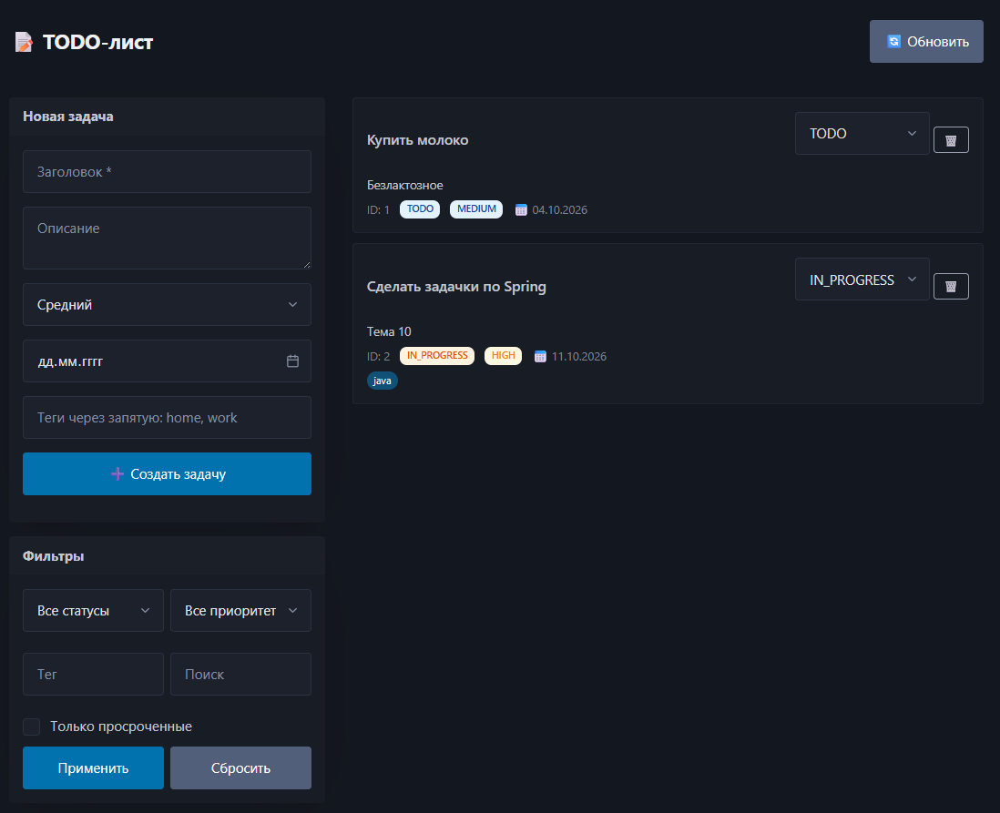

# TODO-лист API + Frontend

Full-stack приложение для управления задачами: **Spring Boot 4** REST API +
**HTML/JS** фронтенд, который отдаётся из того же приложения.

## Содержание

- [Возможности](#возможности)
- [Стек](#стек)
- [Скриншоты](#скриншоты)
- [Быстрый старт](#быстрый-старт)
- [Структура](#структура)
- [Модель данных](#модель-данных)
- [REST API](#rest-api)
    - [Создание задачи](#создание-задачи)
    - [Получение задачи по id](#получение-задачи-по-id)
    - [Список задач с фильтрами](#список-задач-с-фильтрами)
    - [Обновление задачи](#обновление-задачи)
    - [Смена статуса](#смена-статуса)
    - [Удаление задачи](#удаление-задачи)
- [Обработка ошибок](#обработка-ошибок)
- [Observability](#observability)
- [Фронтенд](#фронтенд)
- [Тесты](#тесты)
- [Разработка](#разработка)
- [Roadmap](#roadmap)

## Возможности

### Бэкенд

- ✅ **CRUD** задач (**создание**, **чтение**, **обновление**, **удаление**).
- ✅ **Фильтрация** — **статус** (**несколько**), **приоритет** (**несколько**), **тег**, **поиск** **по** **подстроке**, **диапазон** **дат**, **просроченные**.
- ✅ **Пагинация** и **сортировка** **через** `Pageable` + **whitelist** **полей**.
- ✅ **Валидация** **с** **группами** `Create`/`Update` (**разные** **правила** для POST/PATCH).
- ✅ **Конечный** **автомат** **переходов** **статусов** (**TODO → IN_PROGRESS → DONE**, **CANCELLED**).
- ✅ **Единый** **формат** **ошибок** **ProblemDetail** (**RFC 7807**) **с** `violations`.
- ✅ **Структурные** **JSON-логи** **с** `requestId` (**MDC**).
- ✅ **Бизнес-метрики** **в** **Prometheus** (**created**, **deleted**, **status.changed**, **overdue**...).
- ✅ **Actuator** — **health**, **info**, **metrics**, **prometheus**, **loggers**.

### Фронтенд

- ✅ **Один** **HTML** **+** **один** **JS** **файл** — **без** **npm**, **сборки**, **фреймворков**.
- ✅ **Создание** **задач** **через** **форму**.
- ✅ **Список** **задач** **с** **цветными** **бейджами** **статусов** **и** **приоритетов**.
- ✅ **Смена** **статуса** **из** **карточки** (**селект**).
- ✅ **Удаление** **с** **подтверждением**.
- ✅ **Фильтры** — **статус**, **приоритет**, **тег**, **поиск**, **просроченные**.
- ✅ **Пагинация**.
- ✅ **Toast**-**уведомления** **об** **успехе**/**ошибке**.
- ✅ **Тёмная** **тема** (**автоматически** **по** `prefers-color-scheme`).
- ✅ **Адаптивная** **вёрстка** (**Pico.css**).

## Стек

| Компонент | Версия |
|-----------|--------|
| Java | 21 |
| Spring Boot | 4.1.1 |
| Spring Web | REST + Jackson (snake_case) |
| Spring Data JPA | Hibernate 7 + Specification API |
| H2 Database | in-memory |
| Bean Validation | Jakarta Validation 3 (группы) |
| Micrometer | Prometheus registry |
| Logback | JSON (logstash-encoder) |
| JUnit 5 + MockMvc + Mockito | Тесты |
| **Pico.css** (CDN) | **Фронтенд** |
| **Vanilla JS** | **Без** **фреймворков** |

## Скриншоты

**Главный** **экран** — **форма** **создания**, **фильтры**, **список** **задач**:


## Быстрый старт

### Требования

- **Java** 21+
- **Gradle** (wrapper включён)

### Запуск

```bash
# Клонировать и перейти в проект
cd todo-api

# Запустить приложение
./gradlew bootRun
```

**Открой** **в** **браузере:**

- 🖥 **Фронтенд:** http://localhost:8080/
- 🗄 **H2 Console:** http://localhost:8080/h2-console
- ❤️ **Health:** http://localhost:8080/actuator/health
- 📊 **Metrics:** http://localhost:8080/actuator/metrics
- 📈 **Prometheus:** http://localhost:8080/actuator/prometheus

**H2** подключение: JDBC URL `jdbc:h2:mem:tododb`, user `sa`, password пусто.

### Сборка jar

```bash
./gradlew clean build
java -jar build/libs/todo-api-0.0.1-SNAPSHOT.jar
```

## Структура

```
todo-api/
├── src/main/
│   ├── java/com/example/todo/
│   │   ├── TodoApiApplication.java
│   │   ├── task/
│   │   │   ├── Task.java                    ← JPA-сущность
│   │   │   ├── TaskStatus.java              ← TODO, IN_PROGRESS, DONE, CANCELLED
│   │   │   ├── TaskPriority.java            ← LOW, MEDIUM, HIGH, URGENT
│   │   │   ├── TaskRepository.java          ← JpaRepository + JpaSpecificationExecutor
│   │   │   ├── TaskService.java             ← бизнес-логика
│   │   │   ├── TaskController.java          ← REST endpoints
│   │   │   ├── TaskMetrics.java             ← счётчики, таймеры, gauges
│   │   │   ├── TaskSpecifications.java      ← фильтры для Specification API
│   │   │   ├── dto/
│   │   │   │   ├── TaskRequest.java
│   │   │   │   ├── TaskResponse.java
│   │   │   │   ├── TaskPageResponse.java
│   │   │   │   ├── TaskFilterRequest.java
│   │   │   │   └── ChangeStatusRequest.java
│   │   │   └── exception/
│   │   │       ├── TaskNotFoundException.java
│   │   │       └── InvalidStatusTransitionException.java
│   │   └── common/
│   │       ├── GlobalExceptionHandler.java  ← ProblemDetail
│   │       ├── RequestIdFilter.java         ← MDC + X-Request-Id
│   │       └── validation/
│   │           ├── Create.java
│   │           └── Update.java
│   └── resources/
│       ├── application.yml
│       └── static/                           ← ⭐ ФРОНТЕНД
│           ├── index.html                    ← разметка + стили (Pico.css)
│           └── app.js                        ← вся логика (fetch + render)
└── src/test/java/com/example/todo/task/
    ├── TaskServiceTest.java                  ← unit (Mockito)
    ├── TaskControllerTest.java               ← slice (MockMvc)
    └── TaskRepositoryTest.java               ← slice (@DataJpaTest)
```

## Модель данных

### Task

| Поле | Тип | Обязательное | Описание |
|------|-----|--------------|----------|
| `id` | Long | — | Генерируется |
| `title` | String(200) | ✅ | Заголовок |
| `description` | String(2000) | — | Описание |
| `priority` | Enum | ✅ | LOW / MEDIUM / HIGH / URGENT |
| `status` | Enum | ✅ | TODO / IN_PROGRESS / DONE / CANCELLED |
| `dueDate` | LocalDate | — | Дедлайн |
| `tags` | Set\<String\> | — | До 20 тегов, каждый до 30 символов |
| `createdAt` | Instant | — | Автоматически |
| `updatedAt` | Instant | — | Автоматически |

### Правила переходов статусов

```
TODO       → IN_PROGRESS | CANCELLED
IN_PROGRESS → DONE | TODO | CANCELLED
DONE       → (финальный)
CANCELLED  → (финальный)
```

**Невалидный** **переход** → **409 Conflict**.

## REST API

**Все** **запросы/ответы** — **в** `snake_case`. **Даты** — ISO-8601.
**Content-Type** **для** **ошибок** — `application/problem+json`.

Базовый URL: `http://localhost:8080/api/tasks`

---

### Создание задачи

**POST** `/api/tasks`

```http
POST http://localhost:8080/api/tasks
Content-Type: application/json

{
  "title": "Buy milk",
  "description": "2% fat, from the nearest shop",
  "priority": "MEDIUM",
  "due_date": "2026-10-15",
  "tags": ["shopping", "home"]
}
```

**201 Created**:

```http
HTTP/1.1 201 Created
Location: /api/tasks/1
Content-Type: application/json

{
  "id": 1,
  "title": "Buy milk",
  "description": "2% fat, from the nearest shop",
  "priority": "MEDIUM",
  "status": "TODO",
  "due_date": "2026-10-15",
  "tags": ["shopping", "home"],
  "created_at": "2026-10-02T12:00:00Z",
  "updated_at": "2026-10-02T12:00:00Z"
}
```

**Валидация** (**группа** Create):

| Поле | Правило |
|------|---------|
| `title` | `@NotBlank`, `@Size(1..200)` |
| `priority` | `@NotNull` |
| `dueDate` | `@FutureOrPresent` |
| `tags` | `@Size(≤20)`, **каждый** **тег** `@NotBlank`, `@Size(≤30)` |

---

### Получение задачи по id

**GET** `/api/tasks/{id}`

```http
GET http://localhost:8080/api/tasks/1
```

**200 OK** — **JSON** (**см.** **выше**).

**404 Not Found**:

```json
{
  "type": "https://api.example.com/problems/task-not-found",
  "title": "Task not found",
  "status": 404,
  "detail": "Task with id 9999 not found",
  "instance": "/api/tasks/9999",
  "code": "TASK_NOT_FOUND",
  "taskId": 9999,
  "timestamp": "2026-10-02T12:00:00Z"
}
```

---

### Список задач с фильтрами

**GET** `/api/tasks`

#### Query-параметры

| Параметр | Тип | По умолчанию | Описание |
|----------|-----|--------------|----------|
| `page` | int ≥ 0 | 0 | Номер страницы |
| `size` | int 1..100 | 20 | Размер страницы |
| `sortBy` | enum | `id` | `id`, `title`, `priority`, `status`, `dueDate`, `createdAt`, `updatedAt` |
| `sortDir` | `asc`/`desc` | `asc` | Направление |
| `status` | enum (можно несколько) | — | `?status=TODO&status=IN_PROGRESS` |
| `priority` | enum (можно несколько) | — | `?priority=HIGH&priority=URGENT` |
| `tag` | string | — | **Фильтр** **по** **тегу** |
| `search` | string | — | **Подстрока** **в** title/description (**case-insensitive**) |
| `dueFrom` | ISO date | — | **Дедлайн** ≥ |
| `dueTo` | ISO date | — | **Дедлайн** ≤ |
| `overdue` | boolean | — | **Только** **просроченные** |

#### Примеры

```http
### Базовый
GET http://localhost:8080/api/tasks?page=0&size=10&sortBy=id&sortDir=asc

### Фильтр по тегу и приоритету
GET http://localhost:8080/api/tasks?tag=home&priority=HIGH

### Поиск по подстроке
GET http://localhost:8080/api/tasks?search=spring

### Несколько статусов
GET http://localhost:8080/api/tasks?status=TODO&status=IN_PROGRESS

### Просроченные
GET http://localhost:8080/api/tasks?overdue=true

### Всё вместе
GET http://localhost:8080/api/tasks?status=TODO&priority=HIGH&tag=home&search=clean&dueFrom=2026-10-01&dueTo=2026-10-31&page=0&size=20&sortBy=priority&sortDir=desc
```

**200 OK**:

```json
{
  "content": [
    {
      "id": 1,
      "title": "Buy milk",
      "priority": "MEDIUM",
      "status": "TODO",
      "due_date": "2026-10-15",
      "tags": ["shopping", "home"],
      "created_at": "...",
      "updated_at": "..."
    }
  ],
  "page": 0,
  "size": 10,
  "total": 1,
  "total_pages": 1
}
```

**Валидация**:

- `page < 0` → **422**
- `size > 100` → **422**
- `sortBy` вне whitelist → **422**
- Неверный тип (`?page=abc`) → **400**

---

### Обновление задачи

**PATCH** `/api/tasks/{id}`

**Частичное** **обновление**. **`null`** **или** **отсутствующее** **поле** = **не** **менять**.

```http
PATCH http://localhost:8080/api/tasks/1
Content-Type: application/json

{
  "title": "Buy milk and bread",
  "priority": "HIGH"
}
```

**200 OK** — **обновлённый** **JSON**.

**Валидация** (**группа** Update): **все** **поля** **опциональны**, **но** **если** **пришли** — **валидируются**.

---

### Смена статуса

**PATCH** `/api/tasks/{id}/status`

```http
PATCH http://localhost:8080/api/tasks/1/status
Content-Type: application/json

{
  "status": "IN_PROGRESS"
}
```

**200 OK** — **обновлённая** **задача**.

**Невалидный** **переход** (`DONE` → `TODO`) → **409 Conflict**:

```json
{
  "type": "https://api.example.com/problems/invalid-status-transition",
  "title": "Invalid status transition",
  "status": 409,
  "detail": "Cannot transition task status from DONE to TODO",
  "instance": "/api/tasks/1/status",
  "code": "INVALID_STATUS_TRANSITION",
  "from": "DONE",
  "to": "TODO",
  "timestamp": "2026-10-02T12:00:00Z"
}
```

---

### Удаление задачи

**DELETE** `/api/tasks/{id}`

```http
DELETE http://localhost:8080/api/tasks/1
```

**204 No Content** — **пустое** **тело**.

**Ошибка** **404**, **если** **задачи** **нет**.

---

## Обработка ошибок

**Все** **ошибки** — **в** **формате** **ProblemDetail (RFC 7807)** **с** **Content-Type: `application/problem+json`**.

### Структура

```json
{
  "type": "https://api.example.com/problems/validation-error",
  "title": "Validation failed",
  "status": 422,
  "detail": "Validation failed for 2 field(s)",
  "instance": "/api/tasks",
  "code": "VALIDATION_FAILED",
  "timestamp": "2026-10-02T12:00:00Z",
  "violations": [
    { "field": "title", "code": "NotBlank", "message": "title must not be blank" },
    { "field": "priority", "code": "NotNull", "message": "priority is required" }
  ],
  "requestId": "abc-123"
}
```

### Коды ошибок

| Код | HTTP | Когда |
|-----|------|-------|
| `VALIDATION_FAILED` | 422 | **Ошибки** **валидации** (`@Valid`, **параметры** **метода**) |
| `JSON_INVALID` | 400 | **Кривой** **JSON**, **лишнее** **поле**, **неверный** **enum** **в** **теле** |
| `INVALID_PARAMETER_TYPE` | 400 | **Неверный** **тип** **query**-**параметра** (`?page=abc`) |
| `TASK_NOT_FOUND` | 404 | **Задача** **не** **найдена** |
| `INVALID_STATUS_TRANSITION` | 409 | **Недопустимый** **переход** **статуса** |
| `INTERNAL_ERROR` | 500 | **Непредвиденная** **ошибка** |

### `X-Request-Id`

**Клиент** **может** **передать** `X-Request-Id` — **сервер** **вернёт** **его** **в** **ответе** **и** **в** `requestId` **ошибки**. **Иначе** — **UUID**.

```http
GET http://localhost:8080/api/tasks
X-Request-Id: my-request-42
```

**Ответ**:

```http
HTTP/1.1 200 OK
X-Request-Id: my-request-42
```

## Observability

### Actuator endpoints

| URL | Что |
|-----|-----|
| `/actuator/health` | **Статус** **приложения** (**H2**, **disk**, **ping**) |
| `/actuator/info` | **Информация** **о** **приложении** |
| `/actuator/metrics` | **Все** **метрики** |
| `/actuator/prometheus` | **Метрики** **в** **формате** **Prometheus** |
| `/actuator/loggers` | **Управление** **уровнями** **логов** **в** **рантайме** |

### Бизнес-метрики

| Метрика | Тип | Описание |
|---------|-----|----------|
| `todo_task_created_total` | Counter | **Созданные** **задачи** |
| `todo_task_updated_total` | Counter | **Обновлённые** **задачи** |
| `todo_task_deleted_total` | Counter | **Удалённые** **задачи** |
| `todo_task_status_changed_total` | Counter | **Успешные** **переходы** |
| `todo_task_status_invalid_total` | Counter | **Отклонённые** **переходы** |
| `todo_task_not_found_total` | Counter | **404** **по** **задачам** |
| `todo_task_count_by_status` | Gauge | **Текущее** **число** **задач** **по** **статусам** (**тег** `status`) |
| `todo_task_list_duration_seconds` | Timer | **Длительность** **списка** (p50/p95/p99) |
| `todo_task_create_duration_seconds` | Timer | **Длительность** **создания** (p50/p95/p99) |

**Общие** **теги**: `service="todo-api"`, `env="local"`.

### Проверка метрик

```bash
# Все метрики
curl http://localhost:8080/actuator/metrics | jq

# Конкретная
curl http://localhost:8080/actuator/metrics/todo.task.created

# Prometheus формат
curl http://localhost:8080/actuator/prometheus | grep todo_task
```

### Логи

**JSON-формат** **с** `requestId` **в** **каждой** **строке**:

```json
{
  "@timestamp": "2026-10-02T12:00:00.123Z",
  "level": "INFO",
  "logger": "com.example.todo.task.TaskService",
  "thread": "http-nio-8080-exec-1",
  "message": "Task created id=1 title=Buy milk priority=MEDIUM",
  "service": "todo-api",
  "env": "local",
  "requestId": "abc-123"
}
```

## Фронтенд

**Отдаётся** **из** `src/main/resources/static/` **на** http://localhost:8080/.

### Технологии

- **HTML5** + **Vanilla JS** (**без** **фреймворков**).
- **Pico.css** (**CDN**) — **минималистичный** **CSS**-**фреймворк**.
- **`fetch`** — **нативный** **HTTP**-**клиент**.
- **Никакой** **сборки** — **нет** **npm**, **webpack**, **babel**.

### Файлы

```
src/main/resources/static/
├── index.html    ← разметка + встроенные стили (~250 строк)
└── app.js        ← вся логика (~300 строк)
```

### Функции

- **Форма** **создания** **задачи** (**title**, **description**, **priority**, **due_date**, **tags**).
- **Фильтры** — **статус**, **приоритет**, **тег**, **поиск**, **просроченные**.
- **Список** **задач** — **карточки** **с** **цветными** **бейджами**.
- **Смена** **статуса** **из** **карточки** — **выпадающий** **список**.
- **Удаление** **с** **подтверждением**.
- **Пагинация** — **кнопки** **Назад/Вперёд**.
- **Toast**-**уведомления** **об** **успехе**/**ошибке**.
- **Тёмная** **тема** **автоматически** **по** `prefers-color-scheme`.
- **Адаптивная** **вёрстка**.

### Как работает

1. **HTML** **отдаётся** **при** **запросе** `/` (**Spring** **Boot** **сам** **находит** `static/index.html`).
2. **JS** **отдаётся** **с** `/app.js`.
3. **Все** `fetch` **идут** **на** **тот** **же** **origin** — **CORS** **не** **нужен**.
4. **Фронт** **шлёт** `snake_case` **в** **JSON** (**требование** **Jackson** **с** `SNAKE_CASE`).
5. **Delegation** **событий** — **один** **обработчик** **на** **динамический** **список**.
6. **`escapeHtml`** — **XSS**-**защита**.

### Что менять

- **Стили** — **в** `<style>` **в** `index.html`.
- **Логика** — **в** `app.js`.
- **URL** **API** — **константа** `const API = '/api/tasks';` **вверху** `app.js`.

## Тесты

```bash
# Все тесты
./gradlew test

# Только unit-тесты сервиса
./gradlew test --tests "com.example.todo.task.TaskServiceTest"

# Только slice-тесты MVC
./gradlew test --tests "com.example.todo.task.TaskControllerTest"

# Только slice-тесты JPA
./gradlew test --tests "com.example.todo.task.TaskRepositoryTest"
```

### Пирамида тестов

| Тип | Класс | Что покрывает |
|-----|-------|---------------|
| **Unit** | `TaskServiceTest` | **Логика** **сервиса** (**Mockito**) |
| **Slice (MVC)** | `TaskControllerTest` | **Контроллер** (`@WebMvcTest` + **MockMvc**) |
| **Slice (JPA)** | `TaskRepositoryTest` | **Репозиторий** + **Specification** (`@DataJpaTest`) |
| **Integration** | `TodoApiApplicationTests` | **Smoke**-**test** (`@SpringBootTest`) |

## Разработка

### Структура БД

**H2 in-memory** **с** `ddl-auto: create-drop` — **таблицы** **создаются** **при** **старте**, **удаляются** **при** **остановке**. **Данные** **не** **сохраняются** **между** **перезапусками**.

**Для** **постоянного** **хранения** **замени** **в** `application.yml`:

```yaml
spring:
  datasource:
    url: jdbc:h2:file:./data/tododb
  jpa:
    hibernate:
      ddl-auto: update
```

### Полезные команды

```bash
# Запуск (в фоне, hot-reload на изменения)
./gradlew bootRun

# Сборка jar
./gradlew clean build

# Запуск jar
java -jar build/libs/todo-api-0.0.1-SNAPSHOT.jar

# Только компиляция
./gradlew compileJava

# Только тесты
./gradlew test

# Очистка
./gradlew clean
```

### H2 Console

Открой http://localhost:8080/h2-console:

- **JDBC URL:** `jdbc:h2:mem:tododb`
- **User Name:** `sa`
- **Password:** (пусто)

**Полезные** **запросы**:

```sql
-- Все задачи
SELECT * FROM TASKS;

-- Задачи с тегами
SELECT t.id, t.title, tt.tag
FROM TASKS t
LEFT JOIN TASK_TAGS tt ON t.id = tt.task_id;

-- Группировка по статусу
SELECT STATUS, COUNT(*) FROM TASKS GROUP BY STATUS;
```

### Смена уровня логирования в рантайме

```bash
# Смотрим текущий уровень
curl http://localhost:8080/actuator/loggers/com.example.todo

# Включаем DEBUG
curl -X POST http://localhost:8080/actuator/loggers/com.example.todo \
  -H "Content-Type: application/json" \
  -d '{"configuredLevel": "DEBUG"}'

# Возвращаем INFO
curl -X POST http://localhost:8080/actuator/loggers/com.example.todo \
  -H "Content-Type: application/json" \
  -d '{"configuredLevel": "INFO"}'
```

## Roadmap

- [ ] **Postgres** + **Docker Compose** + **Flyway**.
- [ ] **Аутентификация** — **Spring** **Security** + **JWT**, **у** **каждого** **пользователя** **свои** **задачи**.
- [ ] **Роли** — **USER**/**ADMIN**.
- [ ] **Swagger UI** — `springdoc-openapi`.
- [ ] **CI** — **GitHub** **Actions** (**сборка** + **тесты** **на** **push**).
- [ ] **Docker** — **Dockerfile** + **docker-compose** (**app** + **Postgres** + **Prometheus** + **Grafana**).
- [ ] **WebSocket** — **live**-**обновления** **у** **всех** **клиентов**.
- [ ] **Kafka** — **события** **создания**/**изменения** **задач**.
- [ ] **Email**-**уведомления** **о** **просроченных** **задачах**.
- [ ] **Экспорт** **в** **CSV/PDF**.

## Лицензия

MIT. Свободно используйте в учебных и коммерческих проектах.